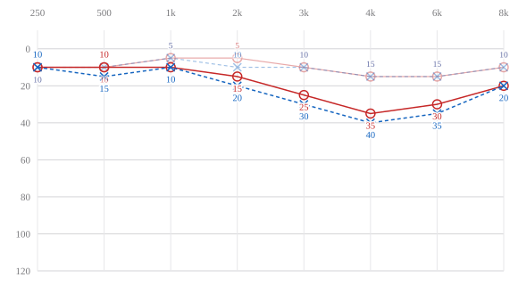

# react-audiogram

A pure-tone audiogram for React, drawn the way audiologists read one.

No dependencies beyond React, no CSS framework, no global styles — just inline
SVG, so it renders the same in a web app, a print stylesheet or a PDF export.



*Current exam over a faded baseline. The dip at 3–4 kHz that recovers at 8 kHz is
the signature of noise exposure — the reason occupational screening tests those
frequencies at all.*

---

## Install

```bash
npm install react-audiogram
```

## Use

```tsx
import { Audiogram } from 'react-audiogram'

<Audiogram
  right={[
    { frequency: 250, db: 10 },
    { frequency: 500, db: 10 },
    { frequency: 1000, db: 10 },
    { frequency: 2000, db: 15 },
    { frequency: 3000, db: 25 },
    { frequency: 4000, db: 35 },
    { frequency: 6000, db: 30 },
    { frequency: 8000, db: 20 },
  ]}
  left={[/* … */]}
/>
```

Comparing an exam against an earlier one — the usual way a change over time is
read, two audiograms superimposed rather than placed side by side:

```tsx
<Audiogram
  right={current.right}
  left={current.left}
  compareTo={{
    right: baseline.right,
    left: baseline.left,
    label: 'baseline, 2024',
  }}
/>
```

Four curves in one plot get crowded. Narrowing to one ear isolates the shift:

```tsx
<Audiogram
  right={current.right}
  left={current.left}
  ears={['left']}
  compareTo={{ left: baseline.left, label: 'baseline, 2024' }}
/>
```

## Props

| Prop | Type | Default | |
|---|---|---|---|
| `right` | `Threshold[]` | — | Right ear thresholds |
| `left` | `Threshold[]` | — | Left ear thresholds |
| `compareTo` | `{ right?, left?, label? }` | — | A second exam, drawn faded behind |
| `ears` | `('right' \| 'left')[]` | both | Which ears to draw |
| `frequencies` | `number[]` | 250 … 8000 | The x-axis, in hertz |
| `showValues` | `boolean` | `true` | Print each threshold beside its marker |
| `showLegend` | `boolean` | `true` | Draw the legend below the plot |
| `background` | `string` | `#ffffff` | Page colour, used to halo the value labels |
| `label` | `string` | `Pure-tone audiogram` | For assistive technology |
| `className`, `style` | | | Applied to the wrapping `<figure>` |

```ts
type Threshold = {
  frequency: number  // test tone in hertz
  db: number         // hearing level in dB HL — higher is worse
}
```

## The conventions it follows

**The decibel axis runs downward.** Better hearing sits at the top. Everyone who
reads audiograms expects this, and inverting it makes a chart unreadable to them
even though the data is identical.

**Right ear red with circles, left ear blue with crosses.** The colours are the
universal convention — but colour is never the only channel. The right ear is
drawn with circles and a solid line, the left with crosses and a dashed one, so
the two stay distinguishable to the common colour vision deficiencies, which are
exactly the ones red and blue collapse.

**Untested frequencies leave a gap.** The line is not drawn through them. A
straight segment across a skipped frequency shows a reading nobody took, and
0 dB HL is a perfectly good threshold — so "not measured" and "measured as zero"
must never look the same.

**Value labels bracket the gap.** Where a current exam and its baseline both have
a reading at the same frequency, whichever sits higher takes the upper label and
the other takes the lower one. The two numbers then enclose the shift being
measured instead of landing on top of each other.

**Frequencies are spaced evenly, not logarithmically.** Clinical audiograms are
read against a table of the same columns, and even spacing keeps chart and table
aligned.

## What it doesn't do

It draws thresholds. It does not interpret them.

No pure-tone average, no standard threshold shift, no significant-change flag, no
degree-of-loss classification. Those are clinical determinations with
jurisdiction-specific criteria, and a charting component is the wrong place to
bury them — the number that drives a fitness-for-work decision should come from
code someone owns and can point at, not from a default inside a library.

Bone conduction and masking symbols are not implemented either. The component
covers air conduction, which is what occupational screening uses.

## Why it exists

Extracted from a clinical records system built for an audiology practice that
performs annual hearing tests for companies' employees. The charting turned out
to be the part with no good off-the-shelf answer, so it became its own thing.

## Licence

MIT
